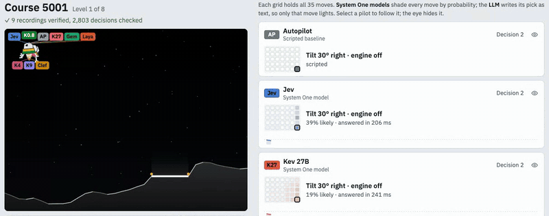

# Low Gate

AI decision models fly the same seeded lunar-lander courses, and the benchmark measures their judgment. Each decision picks one manoeuvre from a fixed menu of 35 (a target tilt and a throttle level, held for one second). The game waits for every answer, so latency and cost are measured and shown, but never change the score.

The name comes from Apollo: low gate is the point in the descent where the crew took over and chose where to touch down.

[](https://lowgate.erenterakye.com)

Watch every course at [lowgate.erenterakye.com](https://lowgate.erenterakye.com), see the full results with 95% intervals on the [results page](https://lowgate.erenterakye.com/results), or read the [write-up](https://erenterakye.com/blog/flying-a-lander-with-system-one-models/). The rules and milestones are in [docs/redesign.md](docs/redesign.md); lane setup and measurements are in [docs/lanes.md](docs/lanes.md).

## Results

20 courses of 8 levels per lane, ranked by landing rate.

| Lane | Type | Landed | Landing quality | Median answer |
| --- | --- | --- | --- | --- |
| Autopilot | Script | 159/160 (99%) | 42.3 | 0 ms |
| Jev | System One | 156/160 (98%) | 46.7 | 203 ms |
| Kev 27B | System One | 151/160 (94%) | 47.4 | 239 ms |
| Gemma 4 12B | LLM | 147/160 (92%) | 46.8 | 5,490 ms |
| Laya | System One | 142/160 (89%) | 41.1 | 199 ms |
| Kev 9B | System One | 118/160 (74%) | 46.2 | 82 ms |
| Clef-flash | System One | 75/160 (47%) | 40.7 | 508 ms |
| Kev 4B | System One | 5/160 (3%) | 40.6 | 61 ms |
| Kev 0.8B | System One | 0/160 (0%) | – | 28 ms |

Landing quality is a 0–100 score for the levels a lane landed: equal parts how close to the pad centre, how gently, and how much fuel was left. The numbers come from `bench/results.json`, which `pnpm bench --summary` rebuilds from the recordings in `bench/`.

The first, real-time version of the arena is kept under the tag [`v0-realtime`](https://github.com/ErenTerakye/lowgate/tree/v0-realtime).

## Lanes

| Lane | Kind | Runs on |
|---|---|---|
| Jev | System One decision model | TypeSafe API |
| Clef-flash | System One decision model | Cloudflare Workers AI |
| Kev 0.8B, 4B, 9B, 27B | Open-weight System One decision models | Colab G4 GPU, via `bridge/kev/kev_colab.ipynb` |
| Laya | Decision model, fine-tuned for the menu | M3 MacBook Pro, 16 GB (MLX), via `bridge/laya/server.py` |
| Gemma 4 12B | Chat model, answers in JSON | M3 MacBook Pro, 16 GB (LM Studio) |
| Autopilot | Scripted baseline | In process |

## Run locally

```bash
pnpm install
cp .env.example .env   # add your own keys; .env is never committed
pnpm dev               # replays at http://localhost:5173, results at /results.html
pnpm test
pnpm typecheck
pnpm bench             # 20 courses per lane, resumable, recordings in bench/
pnpm bench --summary   # rebuild bench/results.json from the recordings
```

## Deploy

The site is static: replays and results are built from `bench/` and need no server or key. It runs as a Cloudflare Worker with static assets only (`apps/web/wrangler.jsonc`), on the free plan, at [lowgate.erenterakye.com](https://lowgate.erenterakye.com).

```bash
pnpm exec wrangler login
pnpm deploy:web        # build, then upload apps/web/dist
```

## How it works

- **Deterministic engine** (`packages/engine`, version `descent-3`): pure TypeScript, seeded PRNG, fixed 60 Hz physics, one decision per second. Level *n* of a course is a pure function of `(seed, n)`, so every lane flies the same terrain and wind, and every recording replays bit-for-bit.
- **Decision layer** (`packages/decisions`): one adapter for System One models and one for chat models, a lockstep runner, failure rules, recordings checked by replay, and summary statistics with intervals.
- **Ranking:** landing rate over 160 levels (20 courses of 8), ties broken by a landing-quality score built from distance to the pad, touchdown speed and fuel left.

## Licence

MIT. See [LICENSE](LICENSE).
